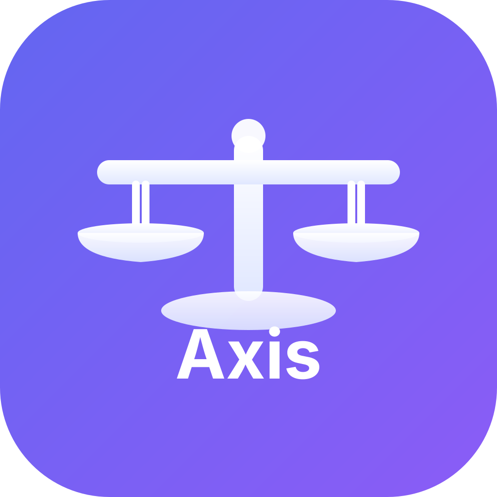
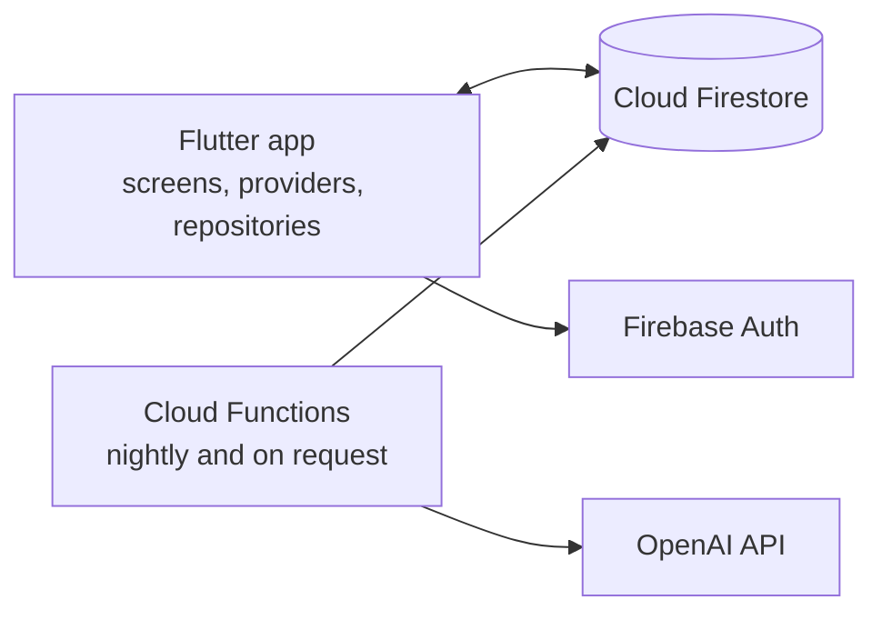

# Axis

A Flutter app for iPhone and Mac that helps you plan the day, build habits across five areas of life, and reflect each evening. A Cloud Function reads your reflections and writes back a short summary and a prompt for tomorrow.

<p align="center">
  
</p>

<!-- Screenshots: add home.png, habits.png and reflection.png to docs/ and uncomment this table.
| Home | Habits | Reflection |
|---|---|---|
|  |  |  |
-->

**Stack:** Dart · Flutter · Provider · go_router · Firebase Auth · Cloud Firestore · Cloud Functions (Node.js) · OpenAI API

## Features

- **Home dashboard:** today's tasks, a habit snapshot, current streaks, a mini calendar, and the latest AI insight
- **Habits by life area:** Soul and Spirit, Health and Energy, Family and Relationships, Work and Calling, and Money and Wealth, with streaks and charts
- **Tasks and schedules:** tasks with due dates, time estimates, and categories, plus daily, weekly, biweekly, or monthly recurring schedules shown on a calendar
- **Daily reflection:** a journal entry with mood and energy (1–10), gratitude, wins, challenges, and tags
- **AI feedback:** Cloud Functions send a user's reflections to OpenAI (`gpt-4o-mini`) every night and on request, then save a daily summary and the next day's prompt
- **Reminders:** local notifications for scheduled items, plus light and dark themes

## How it works



The app reads and writes habits, tasks, schedules, and reflections in Firestore through repository classes, and Provider keeps the screens in sync. The Cloud Functions hold the OpenAI key, so it never ships inside the app.

## Run it locally

Requires the Flutter SDK (Dart 3), Xcode, a Firebase project, the [Firebase CLI](https://firebase.google.com/docs/cli), and the [FlutterFire CLI](https://firebase.google.com/docs/flutter/setup).

```bash
git clone https://github.com/Diggy-DB/Axis.git
cd Axis/axis
cp .env.example .env
flutterfire configure        # writes lib/firebase_options.dart for your Firebase project (git-ignored)
flutter pub get
flutter run -d macos         # or pick an iOS simulator
```

To deploy the Firestore rules and the AI functions (Node.js 20):

```bash
cd functions && npm install && cd ..
firebase functions:secrets:set OPENAI_API_KEY
firebase deploy --only firestore,functions
```

## Project structure

```
axis/lib/
  core/            config, constants, router, theme
  models/          habits, tasks, schedules, reflections, daily summaries
  providers/       app state (Provider)
  repositories/    Firestore reads and writes
  screens/         home, habits, tasks, calendar, reflection, statistics, settings
  services/        notifications and AI clients
  widgets/         dashboard sections and shared UI
functions/         Cloud Functions: nightly and on-demand AI insights
firestore.rules    security rules
ai_backend/        an early FastAPI recommendation service (not connected to the app yet)
```

## Status and next steps

- **Tests:** only a placeholder test so far. Widget tests for the main screens are next.
- **Recommendation service:** `ai_backend/` isn't called by the app yet. The plan is to merge its pattern analysis into the Cloud Functions.

---

<sub>Built by [Delger Byambasukh](https://github.com/Diggy-DB) · [Portfolio](https://diggy-db.github.io) · [Write-up](https://diggy-db.github.io/projects/axis/)</sub>
